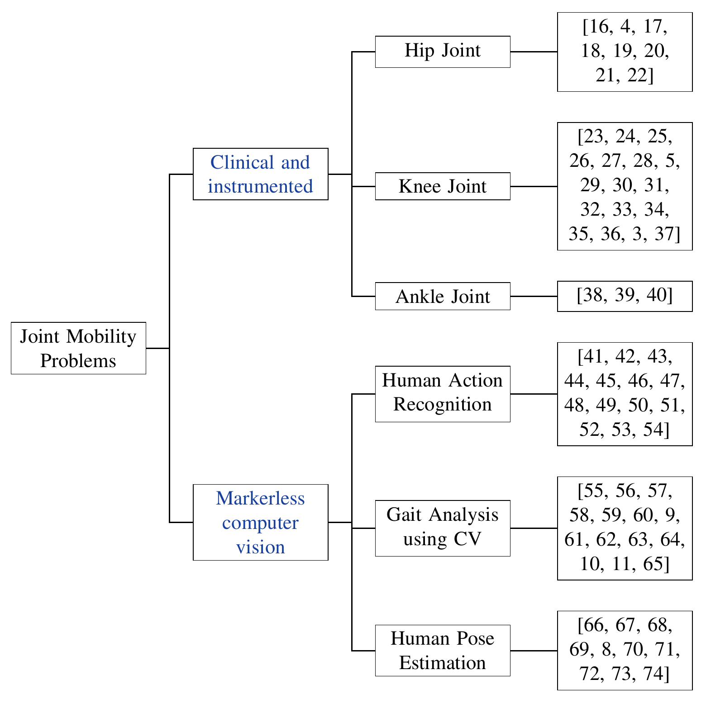
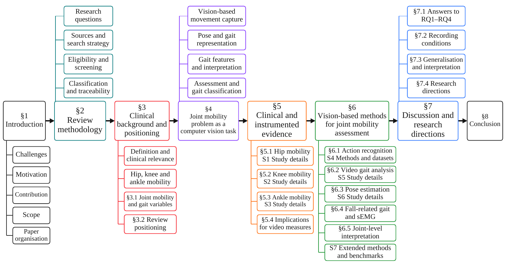

# Vision-Based Gait Analysis for Identifying Lower-Limb Joint Mobility Disorders: A Comprehensive Survey

   

This repository accompanies a survey of vision-based gait analysis for hip, knee and ankle mobility. It brings together the paper’s figures, a reading guide and the references used to interpret the evidence.

**Authors**

Vikas Kumawat, Hari Mohan Pandey, Yashvardhan Sharma, Ashutosh Bhatia and Kamlesh Tiwari.

[Purpose](#purpose) · [Key contributions](#key-contributions) · [How to read the review](READING_GUIDE.md) · [Review method and limits](METHODOLOGY.md) · [Full bibliography](REFERENCES.md) · [Reference data](references/README.md) · [Figure gallery](figures/README.md) · [Verification](VERIFICATION.md)

## Purpose

The review asks which changes in walking associated with hip, knee and ankle mobility can be measured from video, and what evidence is needed to interpret those measurements. It connects clinical and instrumented gait studies with work on action recognition, video gait analysis and pose estimation.

## Key contributions

1. **Joint-specific gait measures.** Identifies variables that reflect hip, knee and ankle impairment and notes where movement at an adjacent joint can affect the measurement.
2. **Clinical targets and video outputs.** Links each measurement target to the landmarks, camera setup and estimate required. The ankle-swing example shows how this relationship works for a single joint angle.
3. **Validation for different claims.** Describes the evidence needed to estimate movement, recognise a gait pattern or assess severity and change in a clinical population.
4. **Recording conditions that affect repeat measurements.** Discusses self-occlusion during swing, loose clothing and changing illumination, and identifies what to report when testing under these conditions.
5. **A guide to the supporting evidence.** Connects the main findings to supplementary sections S1–S7, the comparison tables and the original citations.

## At a glance

| Item | Included |
| --- | ---: |
| Bibliography entries | 116 |
| Cited in the main manuscript or supplement | 106 |
| Additional entries supplied in BibTeX | 10 |
| Primary categories | 12 |
| Manuscript figures | 12 |

## Literature map

The figure shows the two evidence branches used in the paper. The table covers the four themes used to browse the full catalogue. Counts describe bibliography entries. [Open the PDF](figures/Figure_04_Literature_Taxonomy.pdf)

| Theme | Categories | References |
| --- | --- | ---: |
| Clinical and instrumented evidence | 1–4 | 55 |
| Computer vision methods | 5–7 | 35 |
| Validation and recording conditions | 8–10 | 14 |
| Related gait and fall applications | 11–12 | 12 |

## Where to start

- **Hip, knee or ankle mobility.** Start with categories 1–3, then follow the studies in S1–S3 of the supplement.
- **Video methods.** Read categories 5–7 with Figures 8–10 and the matching comparisons in S4–S6.
- **Validation and recording conditions.** Use categories 8–10 with the review axes in Figure 2 and the discussion in §7.
- **Gait recognition and fall-related evidence.** Use categories 11–12 and the endpoint comparisons in §6.4.

[Reading guide](READING_GUIDE.md)

## Figures

The figures follow the manuscript numbering. Figure 1 links Sections 1–8 of the paper to S1–S7 in the separate supplementary file.

| Figure | Topic | Files |
| ---: | --- | --- |
| 1 | Survey roadmap | [PDF](figures/Figure_01_Survey_Roadmap.pdf) · [Preview](figures/Figure_01_Survey_Roadmap.png) |
| 2 | Clinical target, vision output and validation | [PDF](figures/Figure_02_Review_Axes.pdf) · [Preview](figures/Figure_02_Review_Axes.png) |
| 3 | Screening and eligibility | [PDF](figures/Figure_03_Review_Flow.pdf) · [Preview](figures/Figure_03_Review_Flow.png) |
| 4 | Classification of the literature | [PDF](figures/Figure_04_Literature_Taxonomy.pdf) · [Preview](figures/Figure_04_Literature_Taxonomy.png) |
| 5 | Gait cycle | [PDF](figures/Figure_05_Gait_Cycle.pdf) · [Preview](figures/Figure_05_Gait_Cycle.png) |
| 6 | Joint mobility problems | [PDF](figures/Figure_06_Joint_Mobility.pdf) · [Preview](figures/Figure_06_Joint_Mobility.png) |
| 7 | Hip, knee and ankle range of motion | [PDF](figures/Figure_07_Joint_Range_of_Motion.pdf) · [Preview](figures/Figure_07_Joint_Range_of_Motion.png) |
| 8 | Action recognition for joint mobility assessment | [PDF](figures/Figure_08_Action_Recognition.pdf) · [Preview](figures/Figure_08_Action_Recognition.png) |
| 9 | Skeleton-based action recognition | [PDF](figures/Figure_09_Skeleton_Based_Action_Recognition.pdf) · [Preview](figures/Figure_09_Skeleton_Based_Action_Recognition.png) |
| 10 | Human pose estimation for joint mobility assessment | [PDF](figures/Figure_10_Pose_Estimation.pdf) · [Preview](figures/Figure_10_Pose_Estimation.png) |
| 11 | Timeline of selected studies | [PDF](figures/Figure_11_Literature_Timeline.pdf) · [Preview](figures/Figure_11_Literature_Timeline.png) |
| 12 | Computer vision research directions | [PDF](figures/Figure_12_Research_Directions.pdf) · [Preview](figures/Figure_12_Research_Directions.png) |

[Browse the figure gallery and reading notes](figures/README.md)

## Classified literature

Each reference has one primary category. The catalogue also records citation keys, manuscript reference numbers and the supplementary sections where a work appears. Titles link to a publication record where a DOI or URL is available.

| Category | References | Paper sections |
| --- | ---: | --- |
| [1. Hip mobility and gait](#category-1) | 12 | §5.1 and S1 |
| [2. Knee mobility and gait](#category-2) | 27 | §5.2 and S2 |
| [3. Ankle and foot mobility](#category-3) | 4 | §5.3 and S3 |
| [4. Clinical background and gait assessment](#category-4) | 12 | §§1, 3 and 5.4 |
| [5. Human action recognition](#category-5) | 12 | §6.1 and S4 |
| [6. Video-based gait and joint measurement](#category-6) | 13 | §6.2 and S5 |
| [7. Human pose estimation and posture](#category-7) | 10 | §6.3 and S6 |
| [8. Agreement, repeatability and clinical validation](#category-8) | 7 | §§5.4, 6.5 and 7.3 |
| [9. Occlusion, clothing and illumination](#category-9) | 4 | §7.2 |
| [10. Datasets and benchmark methods](#category-10) | 3 | §6.1 and S7 |
| [11. Gait recognition and biometrics](#category-11) | 7 | §§2.5, 3.2 and 6.2 |
| [12. Fall-related gait and complementary sensing](#category-12) | 5 | §6.4 |

### 1. Hip mobility and gait

12 references · §5.1 and S1

Hip osteoarthritis and arthroplasty studies describe changes in hip motion, walking speed, symmetry and movement at adjacent joints.

Check the walking speed and which limb was measured. Hip impairment can also affect loading at the knee.

- [4] Asymmetric knee loading in advanced unilateral hip osteoarthritis — Arthritis & Rheumatism: Official Journal of the American College of Rheumatology (2003). [Full citation](REFERENCES.md#ref-shakoor2003asymmetric)
- [16] Effect of walking speed and severity of hip osteoarthritis on gait variability — Journal of Electromyography and Kinesiology (2010). [Full citation](REFERENCES.md#ref-kiss2010effect)
- [17] Kinematic changes in severe hip osteoarthritis measured at matched gait speeds — Journal of Orthopaedic Research (2021). [Full citation](REFERENCES.md#ref-ismailidis2021kinematic)
- [18] A classification study of kinematic gait trajectories in hip osteoarthritis — Computers in biology and medicine (2014). [Full citation](REFERENCES.md#ref-laroche2014classification)
- [19] Biomechanical gait features associated with hip osteoarthritis: Towards a better definition of clinical hallmarks — Journal of Orthopaedic Research (2015). [Full citation](REFERENCES.md#ref-meyer2015biomechanical)
- [20] Subjects with hip osteoarthritis show distinctive patterns of trunk movements during gait-a body-fixed-sensor based analysis — Journal of neuroengineering and rehabilitation (2012). [Full citation](REFERENCES.md#ref-reininga2012subjects)
- [21] Sagittal plane gait characteristics in hip osteoarthritis patients with mild to moderate symptoms compared to healthy controls: A cross-sectional study — BMC musculoskeletal disorders (2012). [Full citation](REFERENCES.md#ref-eitzen2012sagittal)
- [22] Gait analysis of patients with resurfacing hip arthroplasty compared with hip osteoarthritis and standard total hip arthroplasty — The Journal of arthroplasty (2007). [Full citation](REFERENCES.md#ref-mont2007gait)
- [101] Evaluation of an ambulatory system for gait analysis in hip osteoarthritis and after total hip replacement — Gait & posture (2004). [Full citation](REFERENCES.md#ref-aminian2004evaluation)
- [102] Criteria of gait asymmetry in patients with hip osteoarthritis — Physiotherapy Theory and Practice (2012). [Full citation](REFERENCES.md#ref-hodt2012criteria)
- [103] Measuring gait kinematics in patients with severe hip osteoarthritis using wearable sensors — Gait & posture (2020). [Full citation](REFERENCES.md#ref-ismailidis2020measuring)
- [115] Effects of hip joint centre mislocation on gait analysis results — Journal of biomechanics (2000). [Full citation](REFERENCES.md#ref-stagni2000effects)

### 2. Knee mobility and gait

27 references · §5.2 and S2

Studies of knee osteoarthritis, rehabilitation and replacement report changes in knee angles, joint loading, walking patterns and function.

Check whether the result concerns pain, radiographic severity, the knee adduction moment or observed motion. Each outcome needs its own reference.

- [3] Biomechanical changes at the hip, knee, and ankle joints during gait are associated with knee osteoarthritis severity — Journal of orthopaedic research (2008). [Full citation](REFERENCES.md#ref-astephen2008biomechanical)
- [5] Effects of knee osteoarthritis on hip and ankle gait mechanics — Advances in orthopedics (2019). [Full citation](REFERENCES.md#ref-ro2019effects)
- [24] The influence of walking speed on gait parameters in healthy people and in patients with osteoarthritis — Knee surgery, sports traumatology, arthroscopy (2006). [Full citation](REFERENCES.md#ref-bejek2006influence)
- [25] Effect of severity of knee osteoarthritis on the variability of gait parameters — Journal of Electromyography and Kinesiology (2011). [Full citation](REFERENCES.md#ref-kiss2011effect)
- [26] Novel classification of knee osteoarthritis severity based on spatiotemporal gait analysis — Osteoarthritis and cartilage (2014). [Full citation](REFERENCES.md#ref-elbaz2014novel)
- [27] Relation of gait measures with mild unilateral knee pain during walking using machine learning — Scientific Reports (2022). [Full citation](REFERENCES.md#ref-bacon2022relation)
- [28] Gait analysis of patients with knee osteoarthritis before and after chinese massage treatment — Journal of traditional Chinese medicine (2015). [Full citation](REFERENCES.md#ref-qingguang2015gait)
- [29] Gait mechanics after ACL reconstruction: Implications for the early onset of knee osteoarthritis — British journal of sports medicine (2009). [Full citation](REFERENCES.md#ref-butler2009gait)
- [30] Body mass index affects knee joint mechanics during gait differently with and without moderate knee osteoarthritis — Osteoarthritis and Cartilage (2012). [Full citation](REFERENCES.md#ref-harding2012body)
- [31] Biomechanical changes in gait of subjects with medial knee osteoarthritis — Acta ortopedica brasileira (2012). [Full citation](REFERENCES.md#ref-da2012biomechanical)
- [32] Gait characteristics of patients with knee osteoarthritis — Journal of biomechanics (2001). [Full citation](REFERENCES.md#ref-kaufman2001gait)
- [33] Hip and knee joint rotations differ between patients with medial and lateral knee osteoarthritis: Gait analysis of 30 patients and 15 controls — Journal of Orthopaedic Research (2006). [Full citation](REFERENCES.md#ref-weidow2006hip)
- [34] Gait analysis of patients with knee osteoarthritis highlights a pathological mechanical pathway and provides a basis for therapeutic interventions — EFORT open reviews (2016). [Full citation](REFERENCES.md#ref-favre2016gait)
- [35] Gender differences in gait kinematics for patients with knee osteoarthritis — BMC musculoskeletal disorders (2016). [Full citation](REFERENCES.md#ref-phinyomark2016gender)
- [36] Gait and functional status analysis before and after total knee arthroplasty — The Knee (2018). [Full citation](REFERENCES.md#ref-bkaczkowicz2018gait)
- [37] Gait analysis of patients following total knee replacement: A systematic review — The Knee (2007). [Full citation](REFERENCES.md#ref-mcclelland2007gait)
- [44] [A neural network to predict the knee adduction moment in patients with osteoarthritis using anatomical landmarks obtainable from 2D video analysis](https://doi.org/10.1016/j.joca.2020.12.017) — Osteoarthritis and cartilage (2021). [Full citation](REFERENCES.md#ref-boswell2021neural)
- [55] Analysis of gait characteristics of patients with knee arthritis based on human posture estimation — BioMed Research International (2022). [Full citation](REFERENCES.md#ref-lv2022analysis)
- [61] Novel clinical applications of marker-less motion capture as a low-cost human motion analysis method in the detection and treatment of knee osteoarthritis — Journal of Arthritis (2022). [Full citation](REFERENCES.md#ref-armstrong2022novel)
- [78] A study of the gait characteristics of patients with chronic osteoarthritis of the knee — Disability and rehabilitation (2002). [Full citation](REFERENCES.md#ref-al2002study)
- [79] The role of ambulatory mechanics in the initiation and progression of knee osteoarthritis — Current opinion in rheumatology (2006). [Full citation](REFERENCES.md#ref-andriacchi2006role)
- [80] Increased knee joint loads during walking are present in subjects with knee osteoarthritis — Osteoarthritis and cartilage (2002). [Full citation](REFERENCES.md#ref-baliunas2002increased)
- [81] Knee joint loading during gait in healthy controls and individuals with knee osteoarthritis — Osteoarthritis and cartilage (2013). [Full citation](REFERENCES.md#ref-kumar2013knee)
- [82] Knee joint kinematics, kinetics and muscle co-contraction in knee osteoarthritis patient gait — Clinical biomechanics (2009). [Full citation](REFERENCES.md#ref-heiden2009knee)
- [84] Effects of physiotherapy treatment on knee osteoarthritis gait data using principal component analysis — Clinical Biomechanics (2011). [Full citation](REFERENCES.md#ref-gaudreault2011effects)
- [108] Muscle function and gait in patients with knee osteoarthritis before and after muscle rehabilitation — Disability and Rehabilitation (1997). [Full citation](REFERENCES.md#ref-fisher1997muscle)
- [116] Clinical gait evaluation of patients with knee osteoarthritis — Gait & posture (2017). [Full citation](REFERENCES.md#ref-sun2017clinical)

### 3. Ankle and foot mobility

4 references · §5.3 and S3

Ankle osteoarthritis, ankle replacement and foot mobility studies address distal motion, propulsion and compensation during walking.

Identify the phase of the gait cycle and the foot and shank landmarks. Forefoot and ankle restrictions can affect similar gait measures.

- [38] The role of foot and ankle assessment of patients with lower limb osteoarthritis — Physiotherapy (2009). [Full citation](REFERENCES.md#ref-reilly2009role)
- [39] Gait analysis in ankle osteoarthritis and total ankle replacement — Clinical Biomechanics (2007). [Full citation](REFERENCES.md#ref-valderrabano2007gait)
- [40] Effect of end-stage hip, knee, and ankle osteoarthritis on walking mechanics — Gait & posture (2015). [Full citation](REFERENCES.md#ref-schmitt2015effect)
- [111] Effects of loss of metatarsophalangeal joint mobility on gait in rheumatoid arthritis patients — Rheumatology (2006). [Full citation](REFERENCES.md#ref-laroche2006effects)

### 4. Clinical background and gait assessment

12 references · §§1, 3 and 5.4

Clinical texts, reviews and broader gait studies explain the variables used in assessment and why patterns must be interpreted in context.

Use these sources for definitions and measurement choices. Check the joint and comparison group in the relevant primary study.

- [1] Management of common musculoskeletal disorders: Physical therapy principles and methods — Lippincott Williams & Wilkins (2006). [Full citation](REFERENCES.md#ref-hertling2006management)
- [2] Gait analysis as a quantifiable outcome measure in hip or knee osteoarthritis: A systematic review — Joint Bone Spine (2010). [Full citation](REFERENCES.md#ref-ornetti2010gait)
- [6] Present and future of gait assessment in clinical practice: Towards the application of novel trends and technologies — Frontiers in medical technology (2022). [Full citation](REFERENCES.md#ref-hulleck2022present)
- [7] Recent developments in human gait research: Parameters, approaches, applications, machine learning techniques, datasets and challenges — Artificial Intelligence Review (2018). [Full citation](REFERENCES.md#ref-prakash2018recent)
- [23] Gait analysis of adults with generalised joint hypermobility — Clinical Biomechanics (2012). [Full citation](REFERENCES.md#ref-simonsen2012gait)
- [75] Movement disorders and musculoskeletal system: A reciprocal relationship — Movement Disorders Clinical Practice (2022). [Full citation](REFERENCES.md#ref-pandey2022movement)
- [76] Musculoskeletal disorders — Brackenridge’s medical selection of life risks (2026). [Full citation](REFERENCES.md#ref-lu2026musculoskeletal)
- [77] Assessment of lower limb motor function, ambulation, and balance after stroke — Brain & Neurorehabilitation (2022). [Full citation](REFERENCES.md#ref-yoo2022assessment)
- [83] A review of computer vision-based approaches for physical rehabilitation and assessment — Multimedia Systems (2022). [Full citation](REFERENCES.md#ref-debnath2022review)
- [85] [A comprehensive survey on gait analysis: History, parameters, approaches, pose estimation, and future work](https://doi.org/10.1016/j.artmed.2022.102314) — Artificial Intelligence in Medicine (2022). [Full citation](REFERENCES.md#ref-sethi2022comprehensive)
- [92] Latest research trends in gait analysis using wearable sensors and machine learning: A systematic review — Ieee Access (2020). [Full citation](REFERENCES.md#ref-saboor2020latest)
- [106] The potential of computer vision-based marker-less human motion analysis for rehabilitation — Rehabilitation Process and Outcome (2021). [Full citation](REFERENCES.md#ref-hellsten2021potential)

### 5. Human action recognition

12 references · §6.1 and S4

Skeleton and movement representations are used to recognise actions from body landmarks, depth frames or motion sequences.

Read the task label and validation protocol before using a recognition result to support a claim about gait or joint angles.

- [42] Human action recognition by representing 3d skeletons as points in a lie group — Proceedings of the IEEE conference on computer vision and pattern recognition (2014). [Full citation](REFERENCES.md#ref-vemulapalli2014human)
- [46] Skeleton image representation for 3d action recognition based on tree structure and reference joints — 2019 32nd SIBGRAPI conference on graphics, patterns and images (SIBGRAPI) (2019). [Full citation](REFERENCES.md#ref-caetano2019skeleton)
- [47] Skeletal-based classification for human activity recognition — 2022 IEEE international conference on cybernetics and computational intelligence (CyberneticsCom) (2022). [Full citation](REFERENCES.md#ref-suhendar2022skeletal)
- [48] Skeleton-based human activity recognition using ConvLSTM and guided feature learning — Soft Computing (2022). [Full citation](REFERENCES.md#ref-yadav2022skeleton)
- [49] Skeletonnet: Mining deep part features for 3-d action recognition — IEEE signal processing letters (2017). [Full citation](REFERENCES.md#ref-ke2017skeletonnet)
- [51] Action recognition using kinematics posture feature on 3D skeleton joint locations — Pattern Recognition Letters (2021). [Full citation](REFERENCES.md#ref-ahad2021action)
- [52] Human activity recognition using body joint-angle features and hidden markov model — Etri Journal (2011). [Full citation](REFERENCES.md#ref-uddin2011human)
- [53] Hierarchical recurrent neural network for skeleton based action recognition — Proceedings of the IEEE conference on computer vision and pattern recognition (2015). [Full citation](REFERENCES.md#ref-du2015hierarchical)
- [54] Action recognition using attention-joints graph convolutional neural networks — IEEE Access (2019). [Full citation](REFERENCES.md#ref-ahmad2019action)
- [66] A wushu posture recognition system based on MediaPipe — 2022 2nd international conference on information technology and contemporary sports (TCS) (2022). [Full citation](REFERENCES.md#ref-ma2022wushu)
- [93] Human action recognition and prediction: A survey — International Journal of Computer Vision (2022). [Full citation](REFERENCES.md#ref-kong2022human)
- [112] Learning features combination for human action recognition from skeleton sequences — Pattern Recognition Letters (2017). [Full citation](REFERENCES.md#ref-luvizon2017learning)

### 6. Video-based gait and joint measurement

13 references · §6.2 and S5

Video and depth systems estimate gait timing, spatial measures, joint trajectories and range of motion.

Compare like outcomes and views. Check the calibration, units and biomechanical reference for each estimate.

- [8] [Two-dimensional video-based analysis of human gait using pose estimation](https://doi.org/10.1371/journal.pcbi.1008935) — PLoS computational biology (2021). [Full citation](REFERENCES.md#ref-stenum2021two)
- [9] [RGB-d-based method for measuring the angular range of hip and knee joints during home care rehabilitation](https://doi.org/10.3390/s22010184) — Sensors (2022). [Full citation](REFERENCES.md#ref-uccheddu2022rgb)
- [10] [Markerless gait analysis through a single camera and computer vision](https://doi.org/10.1016/j.jbiomech.2024.112027) — Journal of Biomechanics (2024). [Full citation](REFERENCES.md#ref-wang2024markerless)
- [41] Human pose estimation-based real-time gait analysis using convolutional neural network — IEEE Access (2020). [Full citation](REFERENCES.md#ref-rohan2020human)
- [57] Automated analysis and quantification of human mobility using a depth sensor — IEEE journal of biomedical and health informatics (2016). [Full citation](REFERENCES.md#ref-leightley2016automated)
- [59] [Transforming gait: Video-based spatiotemporal gait analysis](https://doi.org/10.1109/EMBC48229.2022.9871036) — 2022 44th annual international conference of the IEEE engineering in medicine & biology society (EMBC) (2022). [Full citation](REFERENCES.md#ref-cotton2022transforming)
- [60] Vision based identification of joint coordinates for marker-less gait analysis — Procedia computer science (2018). [Full citation](REFERENCES.md#ref-prakash2018vision)
- [62] Characterization of a low-cost markerless system for 3D gait analysis — 2020 IEEE international symposium on medical measurements and applications (MeMeA) (2020). [Full citation](REFERENCES.md#ref-juri2020characterization)
- [63] The efficacy of a video-based marker-less tracking system for gait analysis — Computer methods in biomechanics and biomedical engineering (2017). [Full citation](REFERENCES.md#ref-ong2017efficacy)
- [69] Human gait analysis using OpenPose — 2019 fifth international conference on image information processing (ICIIP) (2019). [Full citation](REFERENCES.md#ref-viswakumar2019human)
- [74] Efficient limb range of motion analysis from a monocular camera for edge devices — Sensors (2025). [Full citation](REFERENCES.md#ref-yan2025efficient)
- [98] [Development of a robust, simple, and affordable human gait analysis system using bottom-up pose estimation with a smartphone camera](https://doi.org/10.3389/fphys.2021.784865) — Frontiers in Physiology (2022). [Full citation](REFERENCES.md#ref-viswakumar2022omgait)
- [105] Measurement method of human lower limb joint range of motion through human-machine interaction based on machine vision — Frontiers in Neurorobotics (2021). [Full citation](REFERENCES.md#ref-wang2021measurement)

### 7. Human pose estimation and posture

10 references · §6.3 and S6

Pose and posture studies describe how images become landmark estimates, 3D representations or movement classifications.

Check which joints the system actually detects, how missing landmarks are handled and which outputs were evaluated in people walking.

- [56] Cardboard people: A parameterized model of articulated image motion — Proceedings of the second international conference on automatic face and gesture recognition (1996). [Full citation](REFERENCES.md#ref-ju1996cardboard)
- [67] Human pose estimation based in-home lower body rehabilitation system — 2020 international joint conference on neural networks (IJCNN) (2020). [Full citation](REFERENCES.md#ref-li2020human)
- [68] Surya namaskar: Real-time advanced yoga pose recognition and correction for smart healthcare — arXiv preprint arXiv:2209.02492 (2022). [Full citation](REFERENCES.md#ref-sharma2022surya)
- [71] Improvement of human pose estimation and processing with the intensive feature consistency network — IEEE Access (2023). [Full citation](REFERENCES.md#ref-sheu2023improvement)
- [73] Predicting postural risk level with computer vision and machine learning on multiple sources of images — Engineering Applications of Artificial Intelligence (2025). [Full citation](REFERENCES.md#ref-doong2025predicting)
- [104] Monocular human pose estimation: A survey of deep learning-based methods — Computer Vision and Image Understanding (2020). [Full citation](REFERENCES.md#ref-chen2020monocular)
- [109] LiftPose3D, a deep learning-based approach for transforming two-dimensional to three-dimensional poses in laboratory animals — Nature methods (2021). [Full citation](REFERENCES.md#ref-gosztolai2021liftpose3d)
- [110] Multi-person dance tiered posture recognition with cross progressive multi-resolution representation integration — PLoS One (2024). [Full citation](REFERENCES.md#ref-kao2024multi)
- [113] Openpose: Whole-body pose estimation — Ph. D. dissertation (2019). [Full citation](REFERENCES.md#ref-martinez2019openpose)
- [114] Stochastic tracking of 3D human figures using 2D image motion — Computer vision—ECCV 2000: 6th european conference on computer vision dublin, ireland, june 26–july 1, 2000 proceedings, part II 6 (2000). [Full citation](REFERENCES.md#ref-sidenbladh2000stochastic)

### 8. Agreement, repeatability and clinical validation

7 references · §§5.4, 6.5 and 7.3

Comparisons with reference systems and repeated measurements help establish when a markerless estimate is reliable in the tested setting.

Look at the error in the individual variable and the population used for validation. Detection, agreement and sensitivity to change answer different questions.

- [11] [Clinical gait analysis using video-based pose estimation: Multiple perspectives, clinical populations, and measuring change](https://doi.org/10.1371/journal.pdig.0000467) — PLOS Digital Health (2024). [Full citation](REFERENCES.md#ref-stenum2024clinical)
- [12] [Accuracy, validity, and reliability of markerless camera-based 3D motion capture systems versus marker-based 3D motion capture systems in gait analysis: A systematic review and meta-analysis](https://doi.org/10.3390/s24113686) — Sensors (2024). [Full citation](REFERENCES.md#ref-scataglini2024accuracy)
- [65] Reliability of artificial intelligence-driven markerless motion capture in gait analyses of healthy adults — PLoS One (2025). [Full citation](REFERENCES.md#ref-schoenwether2025reliability)
- [70] The accuracy of markerless motion capture combined with computer vision techniques for measuring running kinematics — Scandinavian Journal of Medicine & Science in Sports (2023). [Full citation](REFERENCES.md#ref-van2023accuracy)
- [72] Evaluating kinect, openpose and blazepose for human body movement analysis on a low back pain physical rehabilitation dataset — Companion of the 2023 ACM/IEEE international conference on human-robot interaction (2023). [Full citation](REFERENCES.md#ref-marusic2023evaluating)
- [95] [Examination of 2D frontal and sagittal markerless motion capture: Implications for markerless applications](https://doi.org/10.1371/journal.pone.0293917) — PLOS ONE (2023). [Full citation](REFERENCES.md#ref-wade2023examination)
- [96] [OpenCap: Human movement dynamics from smartphone videos](https://doi.org/10.1371/journal.pcbi.1011462) — PLOS Computational Biology (2023). [Full citation](REFERENCES.md#ref-uhlrich2023opencap)

### 9. Occlusion, clothing and illumination

4 references · §7.2

These studies test clothing, difficult visibility or lighting, and include pose methods that address ambiguous or crowded scenes.

Separate missing anatomical landmarks during swing from lighting and clothing effects. Check whether the same condition was tested in the relevant gait population.

- [97] [The inter-trial and inter-session reliability of Theia3D-derived markerless gait analysis in tight versus loose clothing](https://doi.org/10.7717/peerj.18613) — PeerJ (2025). [Full citation](REFERENCES.md#ref-augustine2025clothing)
- [99] Human pose estimation in extremely low-light conditions — Proceedings of the IEEE/CVF conference on computer vision and pattern recognition (2023). [Full citation](REFERENCES.md#ref-lee2023lowlight)
- [100] [Full body performance capture under uncontrolled and varying illumination: A shading-based approach](https://doi.org/10.1007/978-3-642-33765-9_54) — Computer vision – ECCV 2012 (2012). [Full citation](REFERENCES.md#ref-wu2012illumination)
- [107] Towards accurate human pose estimation in videos of crowded scenes — Proceedings of the 28th ACM international conference on multimedia (2020). [Full citation](REFERENCES.md#ref-chang2020towards)

### 10. Datasets and benchmark methods

3 references · §6.1 and S7

Dataset and benchmark papers provide examples of the data and protocols used to evaluate gait or skeleton-based recognition methods.

Check whether the outcome is an action class, joint position or clinical gait measure, and whether subjects are held out.

- [43] Action recognition based on a bag of 3d points — 2010 IEEE computer society conference on computer vision and pattern recognition-workshops (2010). [Full citation](REFERENCES.md#ref-li2010action)
- [45] A novel dataset and deep learning-based approach for marker-less motion capture during gait — Gait & Posture (2021). [Full citation](REFERENCES.md#ref-vafadar2021novel)
- [50] Mining actionlet ensemble for action recognition with depth cameras — 2012 IEEE conference on computer vision and pattern recognition (2012). [Full citation](REFERENCES.md#ref-wang2012mining)

### 11. Gait recognition and biometrics

7 references · §§2.5, 3.2 and 6.2

Gait recognition work contributes motion representations and context for distinguishing identification tasks from joint assessment.

Read identity recognition as evidence about representations. Check for separate validation before using one to estimate an angle or impairment.

- [58] Gaitpart: Temporal part-based model for gait recognition — Proceedings of the IEEE/CVF conference on computer vision and pattern recognition (2020). [Full citation](REFERENCES.md#ref-fan2020gaitpart)
- [86] A comprehensive review of past and present vision-based techniques for gait recognition — Multimedia tools and applications (2014). [Full citation](REFERENCES.md#ref-lee2014comprehensive)
- [87] Vision-based gait recognition: A survey — Ieee Access (2018). [Full citation](REFERENCES.md#ref-singh2018vision)
- [88] Biometric recognition by gait: A survey of modalities and features — Computer vision and image understanding (2018). [Full citation](REFERENCES.md#ref-connor2018biometric)
- [89] Trait of gait: A survey on gait biometrics — arXiv preprint arXiv:1903.10744 (2019). [Full citation](REFERENCES.md#ref-isaac2019trait)
- [90] Vision-based approaches towards person identification using gait — Computer Science Review (2021). [Full citation](REFERENCES.md#ref-khan2021vision)
- [91] Deep gait recognition: A survey — IEEE transactions on pattern analysis and machine intelligence (2022). [Full citation](REFERENCES.md#ref-sepas2022deep)

### 12. Fall-related gait and complementary sensing

5 references · §6.4

Video, surface electromyography and related fall-assessment research cover altered gait patterns, functional tests and fall-related endpoints.

Check the endpoint and follow-up. Classifying a recorded pattern and predicting future falls call for different evaluation designs.

- [13] [Computer vision and machine learning-based gait pattern recognition for flat fall prediction](https://doi.org/10.3390/s22207960) — Sensors (2022). [Full citation](REFERENCES.md#ref-chen2022computer)
- [14] [Myoelectric signal and machine learning computing in gait pattern recognition for flat fall prediction](https://doi.org/10.1016/j.medntd.2024.100341) — Medicine in Novel Technology and Devices (2025). [Full citation](REFERENCES.md#ref-zhang2025myoelectric)
- [15] [Fall-related gait pattern recognition based on surface electromyography using a hybrid neural network with transfer learning](https://doi.org/10.1016/j.bspc.2024.106771) — Biomedical Signal Processing and Control (2024). [Full citation](REFERENCES.md#ref-zhang2024fall)
- [64] A computer vision-based system to help health professionals to apply tests for fall risk assessment — Sensors (2024). [Full citation](REFERENCES.md#ref-blasco2024computer)
- [94] Deep learning for computer vision based activity recognition and fall detection of the elderly: A systematic review — Applied Intelligence (2024). [Full citation](REFERENCES.md#ref-gaya2024deep)

## Reference data and checks

- [BibTeX](references/references.bib) for reference managers.
- [CSV](references/references.csv) and [JSON](references/catalogue.json) for filtering by topic, year, section or citation key.
- [Verification table](references/verification.csv), [source checks](references/source_checks.json) and [verification scope](VERIFICATION.md).

All 116 entries were checked against the supplied bibliography and citation lists. The external source checks cover 16 entries.

## Updating the catalogue

Include the citation key, the affected field and the publisher or indexing record when proposing a correction. [Contributing guide](CONTRIBUTING.md)

## Citation and reuse

For the survey, cite Vikas Kumawat, Hari Mohan Pandey, Yashvardhan Sharma, Ashutosh Bhatia and Kamlesh Tiwari, *Vision-Based Gait Analysis for Identifying Lower-Limb Joint Mobility Disorders: A Comprehensive Survey*. For a study or method, cite the original record linked in the bibliography.

The repository’s licence is supplied with the files. Individual publications carry their own rights and licences. [MIT licence](LICENSE)
