# Figures and reader notes

Figure numbers follow the gait survey. Each entry includes the PDF artwork and a preview.

## Figure 1. Survey roadmap

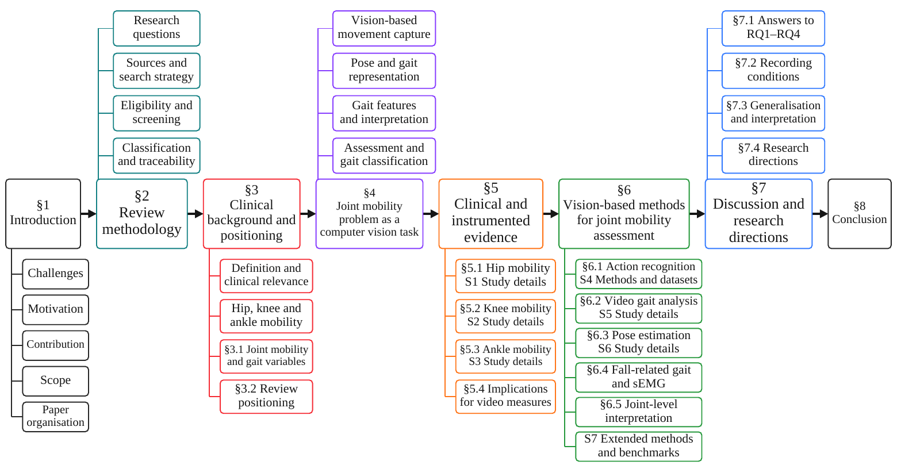

Shows the sequence of the eight main paper sections and where the seven supplementary sections support them.

Use S1–S3 for joint-specific evidence, S4–S6 for methods and S7 for benchmark comparisons.

[PDF](Figure_01_Survey_Roadmap.pdf) · [PNG preview](Figure_01_Survey_Roadmap.png)

## Figure 2. Clinical target, vision output and validation

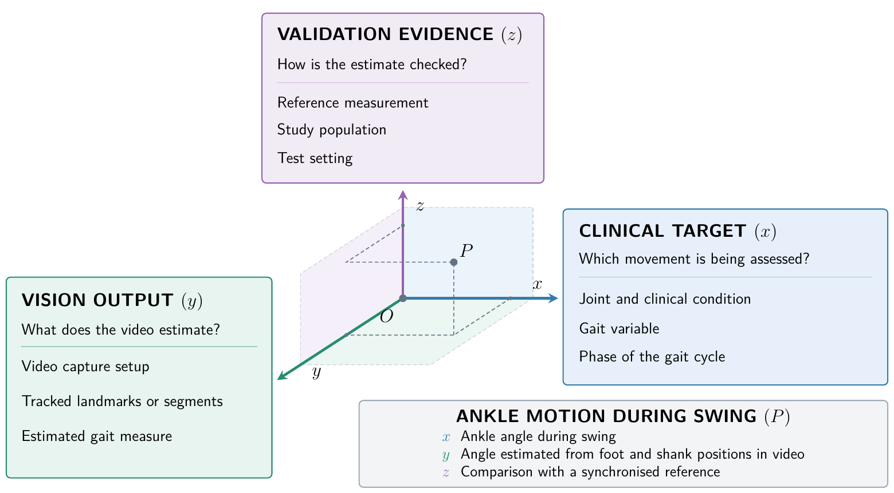

Uses ankle motion during swing to link a clinical variable, a video estimate and a reference measurement.

Write down the joint angle and gait phase before comparing the estimated angle with the synchronised reference.

[PDF](Figure_02_Review_Axes.pdf) · [PNG preview](Figure_02_Review_Axes.png)

## Figure 3. Screening and eligibility

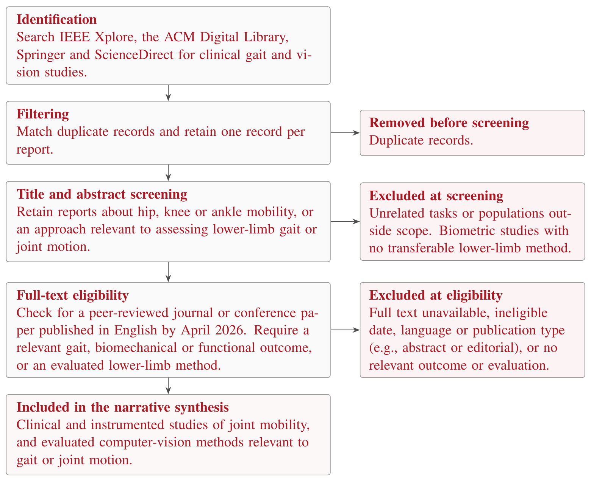

Shows identification, deduplication, title and abstract screening, and full-text eligibility.

Follow the exclusion branches to see which decisions were recorded at each stage.

[PDF](Figure_03_Review_Flow.pdf) · [PNG preview](Figure_03_Review_Flow.png)

## Figure 4. Classification of the literature

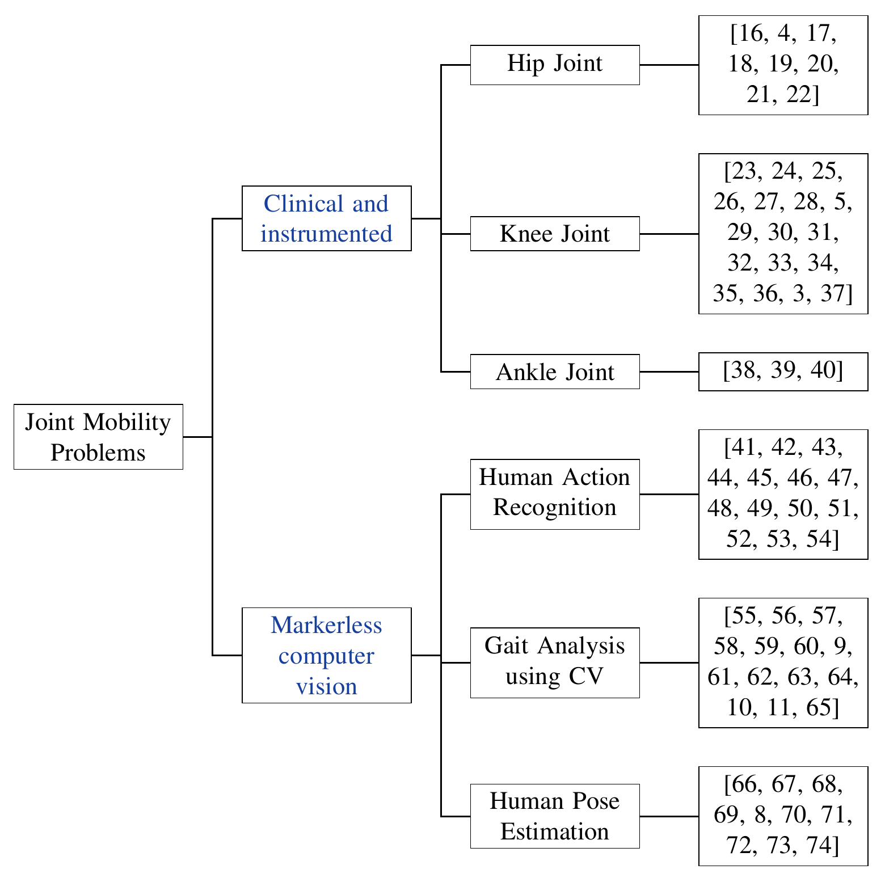

Groups examples of clinical and instrumented evidence alongside human action recognition, video gait and pose estimation.

Use the clinical branch to choose a gait variable and the vision branch to find ways to estimate it.

[PDF](Figure_04_Literature_Taxonomy.pdf) · [PNG preview](Figure_04_Literature_Taxonomy.png)

## Figure 5. Gait cycle

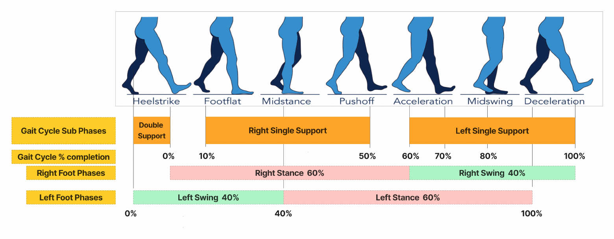

Shows the sequence of events and phases in a gait cycle.

Check the event definitions before comparing joint angles or timing across studies.

[PDF](Figure_05_Gait_Cycle.pdf) · [PNG preview](Figure_05_Gait_Cycle.png)

## Figure 6. Joint mobility problems

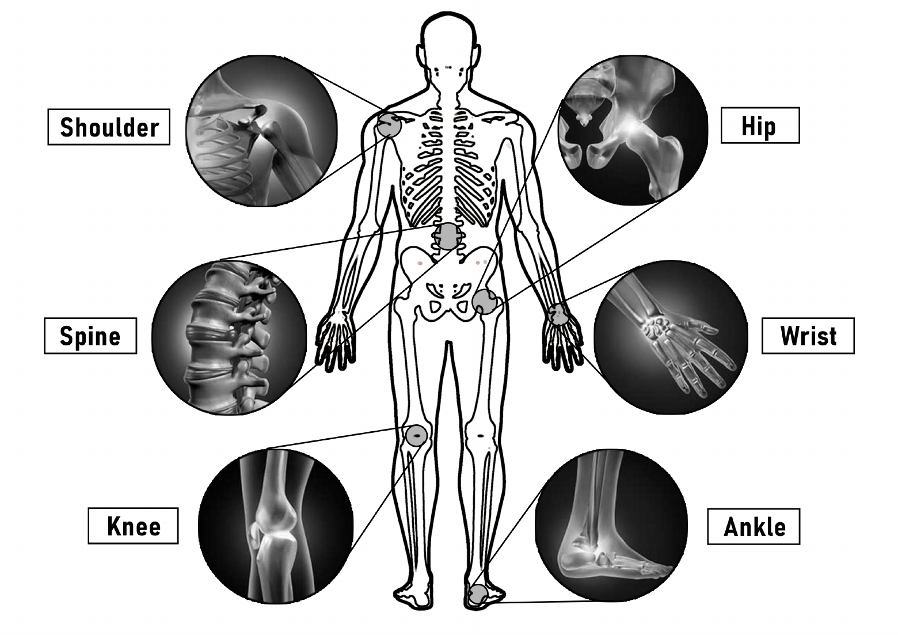

Illustrates joint mobility problems in the body and locates the lower-limb joints covered by the survey.

Read the hip, knee and ankle sections for the joint-specific measures used in walking studies.

[PDF](Figure_06_Joint_Mobility.pdf) · [PNG preview](Figure_06_Joint_Mobility.png)

## Figure 7. Hip, knee and ankle range of motion

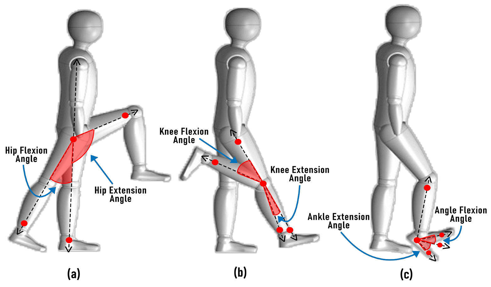

Illustrates sagittal-plane flexion and extension at the hip, knee and ankle.

Check the angle convention and camera view when comparing a video estimate with a reference.

[PDF](Figure_07_Joint_Range_of_Motion.pdf) · [PNG preview](Figure_07_Joint_Range_of_Motion.png)

## Figure 8. Action recognition for joint mobility assessment

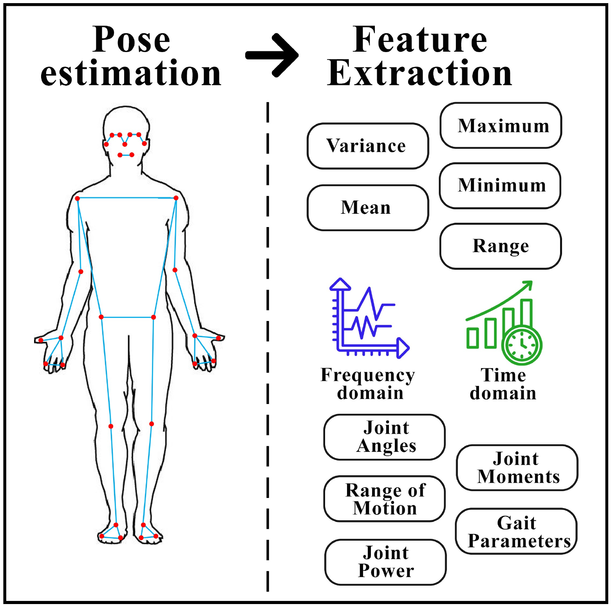

Shows pose estimation followed by extraction of joint, gait and motion features.

Look for a separate angular or temporal validation when a model is used to measure joint movement.

[PDF](Figure_08_Action_Recognition.pdf) · [PNG preview](Figure_08_Action_Recognition.png)

## Figure 9. Skeleton-based action recognition

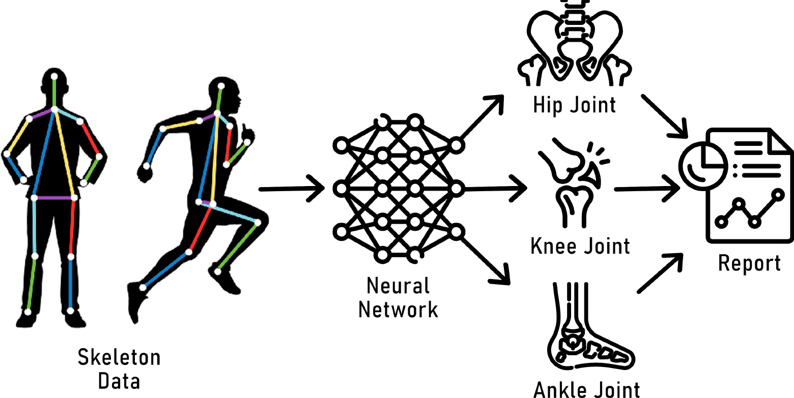

Shows a skeleton-based workflow with a neural network, joint-specific outputs and a report.

Use S4 and S7 to check the dataset, split and outcome behind a classification result.

[PDF](Figure_09_Skeleton_Based_Action_Recognition.pdf) · [PNG preview](Figure_09_Skeleton_Based_Action_Recognition.png)

## Figure 10. Human pose estimation for joint mobility assessment

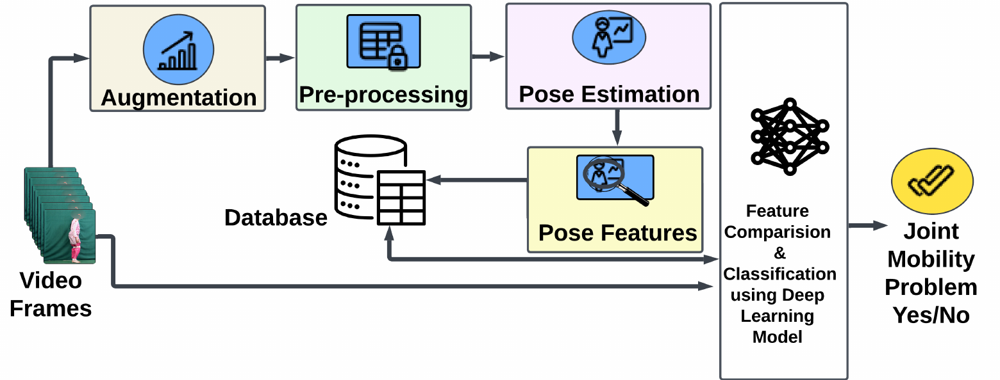

Links body pose estimation to applications in rehabilitation, gait and joint mobility assessment.

Check the visibility of the landmarks and the evaluation setting for the movement of interest.

[PDF](Figure_10_Pose_Estimation.pdf) · [PNG preview](Figure_10_Pose_Estimation.png)

## Figure 11. Timeline of selected studies

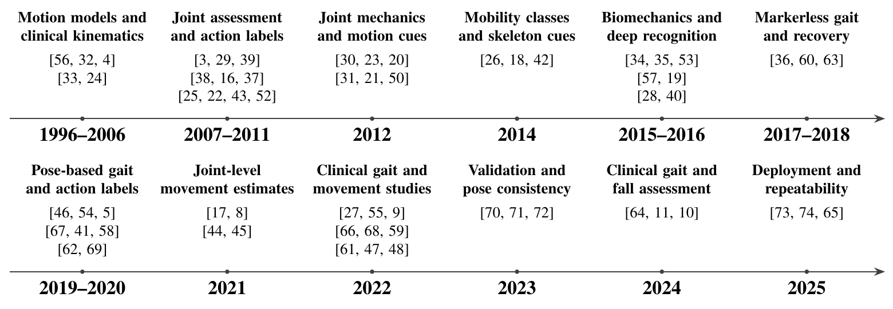

Places selected clinical, gait, action recognition and pose studies in publication order.

Follow the numbered citations to the paper records. The timeline shows examples discussed in the review.

[PDF](Figure_11_Literature_Timeline.pdf) · [PNG preview](Figure_11_Literature_Timeline.png)

## Figure 12. Computer vision research directions

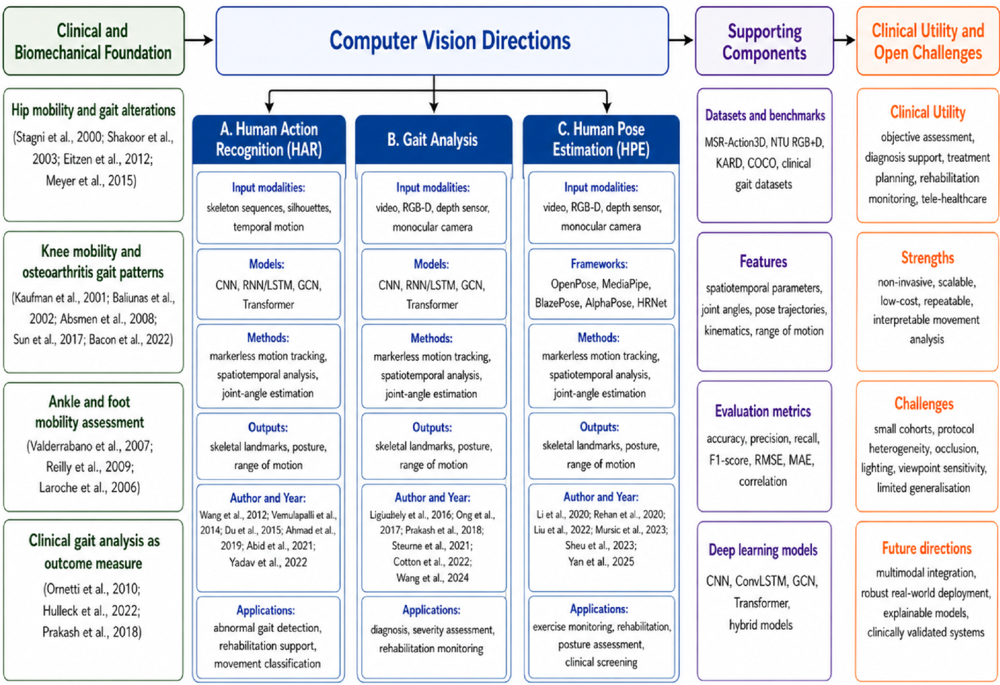

Brings together computer vision methods and research directions for joint mobility assessment.

Read the discussion alongside this figure to identify the population, recording conditions and outcome needed for a follow-up study.

[PDF](Figure_12_Research_Directions.pdf) · [PNG preview](Figure_12_Research_Directions.png)
