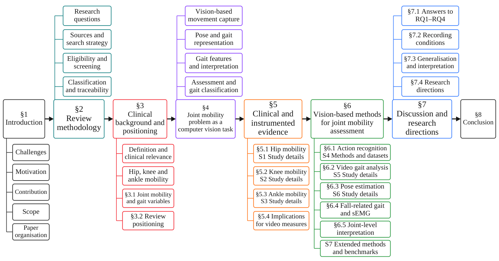

# Vision-Based Gait Analysis for Identifying Lower-Limb Joint Mobility Disorders

## About

This repository accompanies the survey *Vision-Based Gait Analysis for Identifying Lower-Limb Joint Mobility Disorders: A Comprehensive Survey* by Vikas Kumawat, Hari Mohan Pandey, Yashvardhan Sharma, Ashutosh Bhatia and Kamlesh Tiwari. It brings together clinical gait studies and computer vision research on the hip, knee and ankle.

## Purpose and key contributions

Video makes it practical to record walking repeatedly. The question is which changes in movement can be measured from those recordings and what the measurements can tell us about joint mobility.

- Identify gait measures associated with hip, knee and ankle impairment, including changes that arise from compensation at a neighbouring joint.
- Connect those measures to video-based gait analysis, human action recognition and human pose estimation. An ankle angle during swing, for example, requires a clear definition of the angle, estimates of the foot and shank positions and a synchronised reference measurement.
- Examine the evidence needed to measure movement, recognise a gait pattern or make a clinical claim about severity, recovery or future risk. The discussion covers self-occlusion during swing, loose clothing and changing illumination.

## Survey at a glance



S1–S7 are sections of the separate [supplementary material](manuscript/Supplementary_Material.tex).

## Repository contents

| Resource | Contents |
| --- | --- |
| [Manuscript](manuscript/main.tex) | Clinical background, review methodology, evidence synthesis, research questions and directions |
| [Supplement](manuscript/Supplementary_Material.tex) | Joint-specific study details, method comparisons and benchmark tables |
| [Review methodology](manuscript/Review_Methodology.tex) | Search sources, search concepts, eligibility rules and screening decisions |
| [Literature index](literature/README.md) | Bibliography organised by citation key and supplementary section |
| [Figure index](figures/README.md) | Numbered figures with links to their graphics or TikZ source |

## Review methodology

The structured narrative review searched IEEE Xplore, the ACM Digital Library, Springer and ScienceDirect for English-language peer-reviewed work published through April 2026. The search combined gait and joint-mobility terms with terms for video, pose estimation and action recognition.

Studies were screened for relevance to hip, knee or ankle mobility or for an evaluated method applicable to lower-limb gait or joint motion. Full texts were assessed for relevant outcomes, evaluation and publication eligibility. The screening figure shows the decisions at each stage. The source record gives the search terms and sources, and the screening flow is qualitative. [Review methodology](manuscript/Review_Methodology.tex)

## Build the manuscript and supplement

Run these commands with pdfLaTeX, BibTeX and the LaTeX packages listed in the [preamble](manuscript/preamble.tex) installed.

```sh
cd manuscript
latexmk -pdf main.tex
latexmk -pdf Supplementary_Material.tex
```

The commands produce `main.pdf` and `Supplementary_Material.pdf` in the `manuscript/` folder.

## Citation and corrections

The author details and repository citation are available in [CITATION.cff](CITATION.cff). The [BibTeX file](manuscript/bibliography.bib) contains the references used by the two LaTeX documents.

For a citation correction or a study suggestion, include a reference and the joint, method or measurement it concerns. [GitHub issues](https://github.com/profharimohanpandey/vision-gait-joint-disorders-survey/issues)

Licence information is in [LICENSE](LICENSE) and in the header of the bundled [Elsevier class](manuscript/elsarticle.cls).
